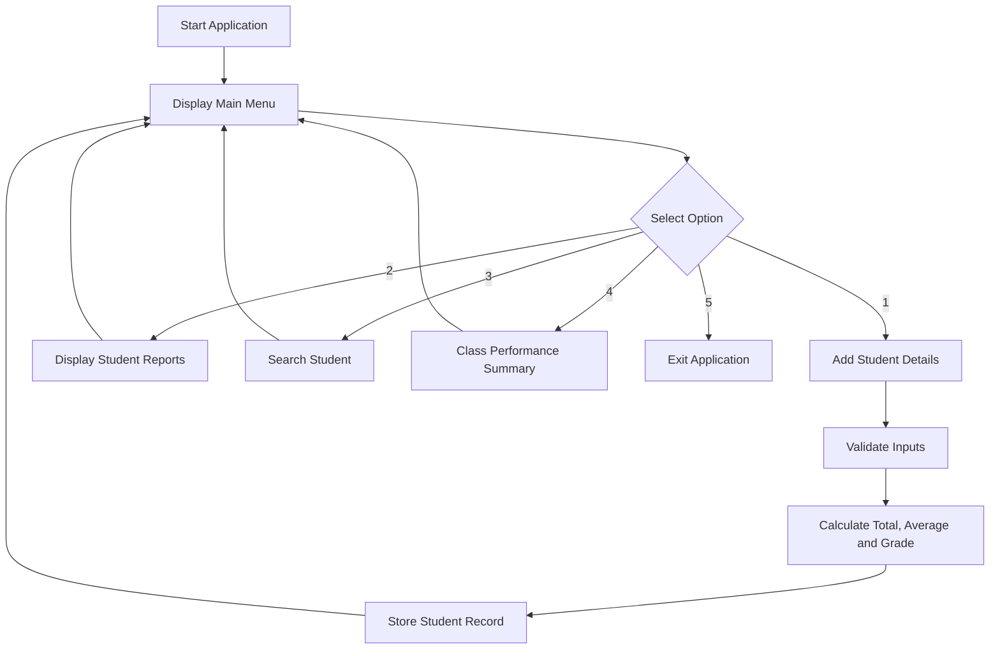

# Student Grade Analyzer


## Project Overview

Student Grade Analyzer is a Python-based, menu-driven console application designed to manage student academic records, calculate grades, generate individual reports, and analyze overall class performance.

This project was developed as part of the **Codomax AIML Internship – Module 01**.

## Features

- Add multiple student records
- Calculate total marks and average percentage
- Automatic grade calculation
- Individual Pass/Fail evaluation
- View all student reports
- Search students using roll numbers
- Class performance analysis
- Class topper identification
- Pass percentage calculation
- Input validation and exception handling
- Duplicate roll number prevention
- User-friendly console interface

## Technologies Used

| Technology | Purpose |
|---|---|
| Python | Application development |
| Google Colab | Development and testing |
| GitHub | Version control and project hosting |

## Subjects

- English
- Mathematics
- Physics
- Chemistry
- Computer Science

Each subject carries 100 marks, with a maximum total of 500 marks.

## Grading System

| Average Percentage | Grade |
|---|---|
| 90 - 100 | A+ |
| 80 - Below 90 | A |
| 70 - Below 80 | B |
| 60 - Below 70 | C |
| 40 - Below 60 | D |
| Below 40 | E |

A student must score at least 40 marks in every subject to pass.

Grade calculation and Pass/Fail evaluation are performed independently.

## Application Menu

```text
====== Student Grade Analyzer ======

1. Add Students
2. View All Student Reports
3. Search Student by Roll Number
4. Class Performance Summary
5. Exit
```

## Project Workflow



## Python Concepts Implemented

- Variables and data types
- Conditional statements
- For and while loops
- Nested loops
- Functions and parameters
- Lists and dictionaries
- Nested dictionaries
- Exception handling
- Boolean flags
- Linear search
- Break and continue statements
- String methods
- F-string formatting
- Input validation

## Sample Student Report

```text
====== Student Details ======

Student Name : Priya
Roll Number  : 101

English          : 85 / 100
Mathematics      : 95 / 100
Physics          : 90 / 100
Chemistry        : 88 / 100
Computer Science : 96 / 100

Total Marks   : 454 / 500
Average Marks : 90.80%
Grade         : A+
Result        : Pass
```

## Sample Class Performance Summary

| Metric | Result |
|---|---|
| Total Students | 3 |
| Passed Students | 2 |
| Failed Students | 1 |
| Class Average | 83.93% |
| Pass Percentage | 66.67% |
| Highest Total Marks | 480 / 500 |
| Class Topper | Divya |

## Testing and Validation

| Test Case | Status |
|---|---|
| Multiple student addition | Passed |
| Student grade calculation | Passed |
| Pass/Fail evaluation | Passed |
| Student search | Passed |
| Class performance summary | Passed |
| Invalid marks validation | Passed |
| Empty input validation | Passed |
| Duplicate roll number validation | Passed |
| Exception handling | Passed |
| Menu navigation | Passed |

All listed test cases were manually tested in Google Colab.

## Getting Started

### Prerequisites

- Python 3.x
- No external libraries required

### Clone the Repository

```bash
git clone https://github.com/gahnamarshams-ui/student-grade-analyzer.git
```

### Navigate to the Project Directory

```bash
cd student-grade-analyzer
```

### Run the Application

```bash
python student_grade_analyzer.py
```

## Project Structure

```text
student-grade-analyzer/
├── student_grade_analyzer.py
├── README.md
└── .gitignore
```

## Current Limitations

- Student records are stored in memory during execution.
- Records are not retained after the application is closed.
- The application currently uses a console-based interface.

## Future Enhancements

- Permanent data storage using SQLite
- CSV and PDF report generation
- Graphical user interface
- Subject-wise performance visualization
- Student record update and deletion
- Advanced academic performance analytics

## Developer

**Gahna M. S.**

B.E. Computer Science and Engineering (Artificial Intelligence and Machine Learning)

Dhaanish Ahmed Institute of Technology

**Internship:** Codomax AIML Internship

**Module:** 01 – Student Grade Analyzer

[GitHub Profile](https://github.com/gahnamarshams-ui)

---

Developed as a practical implementation of Python programming fundamentals and academic performance analysis.
